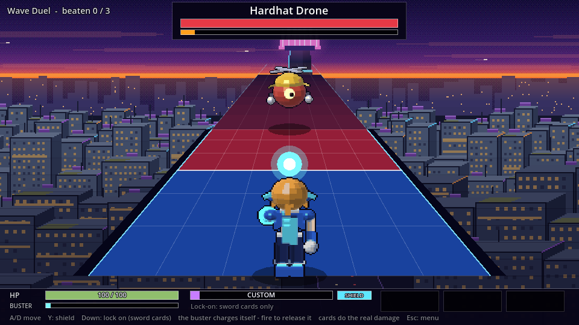
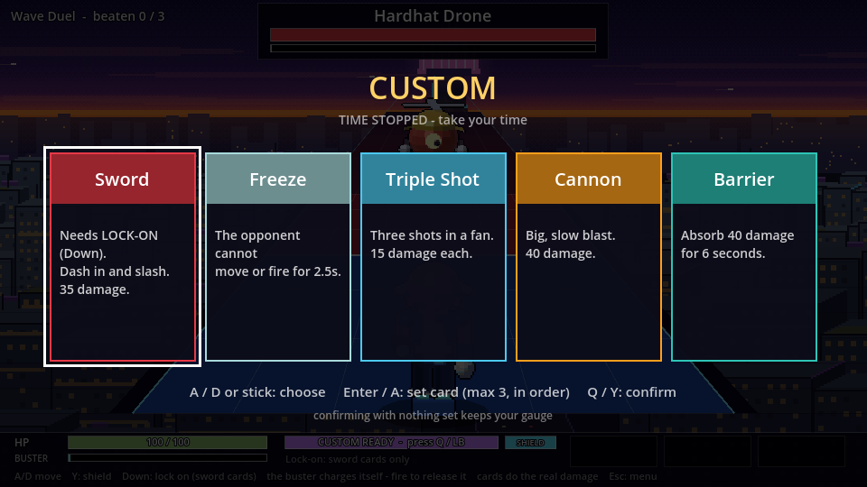
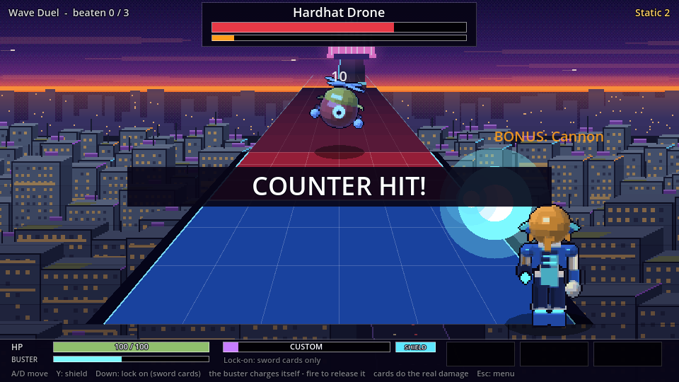
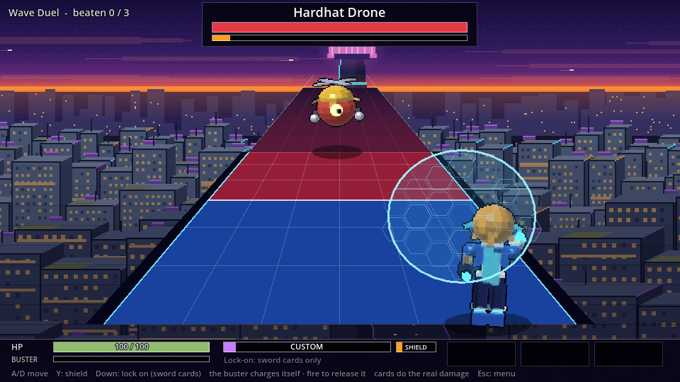
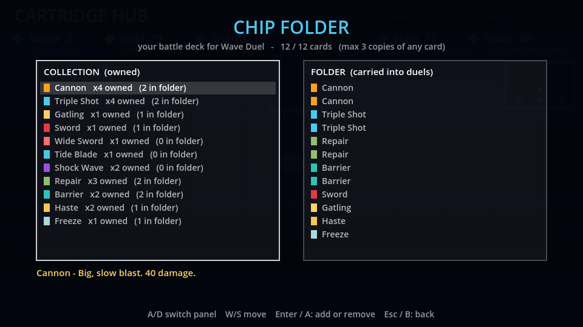
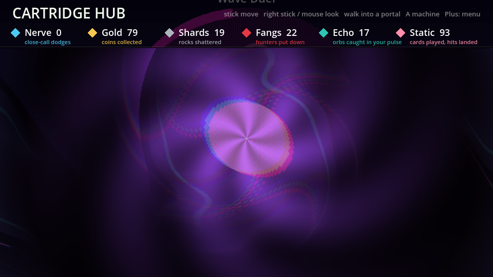
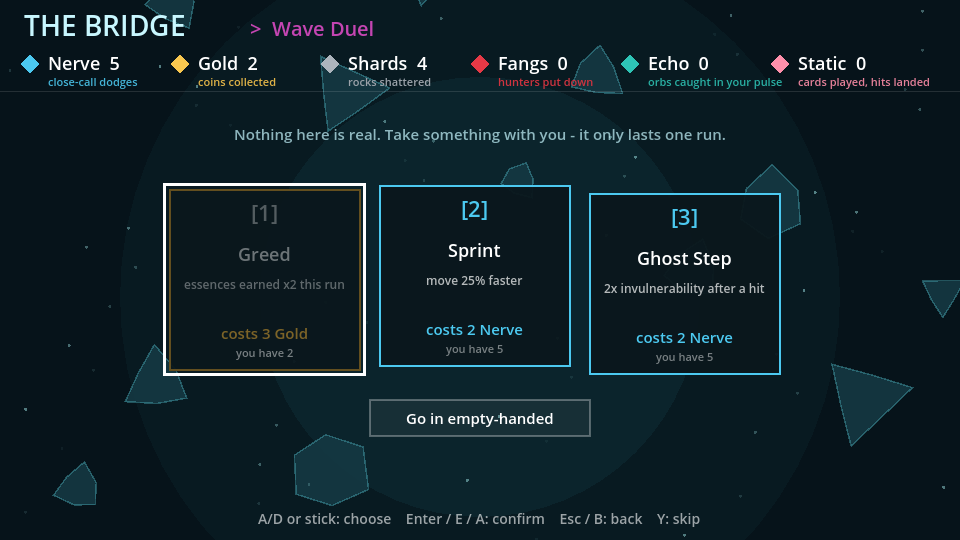
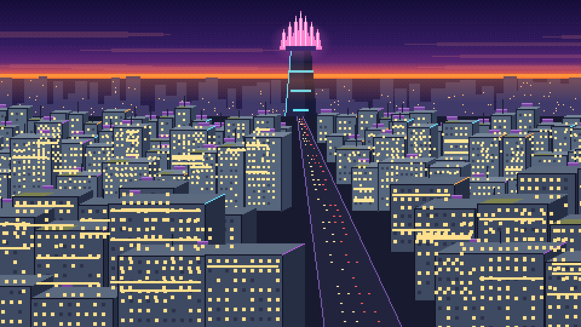

# Cartridge Hub: Wave Duel

A first-person hub world with portals into a real-time card-duel game, built in **Godot 4.3** with pre-rendered 2D sprites
made by my own Python 3D-to-pixel-art tools.

> Not affiliated with or endorsed by Capcom. Inspired by the over-the-shoulder card battles of the Mega Man Star Force series
> and the mid-2000s anime-reploid look; all code and art here are original. No assets, code or audio from any game are used.

## What's in it

**Wave Duel** - a Star Force-inspired real-time card duel seen from behind your fighter.
- A static, high camera: opponents sit far up a glowing "wave road", your fighter low in the foreground.
- A weak auto-charging buster; **cards do the real damage**. A time-based Custom gauge (same tempo for both sides) opens a hand of 5; pick up to 3, played in order.
- **Lock-on + sword cards**: lock on, and your fighter dashes in and slashes. Exposed while doing it.
- **Counter Hit**: land a card on an opponent as it winds up an attack to cancel it and earn a free bonus card.
- **Holographic shield** with a perfect-guard reflect, and **floor-flash telegraphs** showing exactly where an attack will land.
- Three opponents (a hard-hat drone, a golem, a rival who plays cards and swings a sword).

| | |
|---|---|
|  |  |
|  |  |

**The hub** - a Wolfenstein-style raycaster with sprite props. Walk toward a portal and the world bends: a screen-space warp shader swirls the picture into it,
the portal swells to fill your view, and past a ring on the floor you lose control and are pulled in. A per-world `dread` setting scales the effect.

**The Bridge, Chip Folder and essences** - between hub and duel you spend essences on one-run boons; you build a 12-card deck at the folder terminal; wins drop new cards.

## How it's made

- **Godot 4.3, GDScript.** Plug-in worlds load from `games/<id>/manifest.json`, so new games drop in without touching the hub.
- **Pre-rendered sprites, no 3D app.** `tools/anim_render.py` is a small software 3D rasterizer: models are rigs of boxes, cylinders and spheres with joints,
  rendered per animation frame with toon shading, shine and rim light, shrunk to a limited palette and outlined. Heroes, enemies and the animations are generated by it.
- **Pre-rendered city backdrop.** `tools/backdrop_render.py` paints the dusk skyline with ordered dithering.
- **Tested headless.** A bot plays every world (`--selftest`), and `--hudtest` fails the build if any HUD element overlaps another or a text overflows its box.
- **Remappable controls** that accept keys, pad buttons or mouse clicks, whatever the OS delivers.

## Run it

1. Install [Godot 4.3](https://godotengine.org/download/archive/4.3-stable/).
2. Open `project.godot` (or run `godot --path .`). On Windows, double-click `play.bat` (put the path to your Godot exe in `godot_path.txt`, or set a `GODOT` environment variable).

Re-render art (needs Python 3, Pillow, numpy): `python tools/anim_render.py` and `python tools/backdrop_render.py`.

Controls (all rebindable under Esc > Controls, one keyboard key and one controller button per action): **A/D** move, **Space** release the buster,
**Q** open Custom, **Enter** play the next card, **Down** lock on (when a sword card is next), **V** shield, **Esc** menu, **M** mute music, **F11** fullscreen.
Controller: stick/D-pad move, **RB** fire, **LB** Custom, bottom button plays a card, right button shields, top button locks on. Pro Controller supported.

## Docs

- [`docs/PROJECT_NOTES.md`](docs/PROJECT_NOTES.md) - rules, tuning, flags, and gotchas.
- [`docs/starforce_battle_analysis.md`](docs/starforce_battle_analysis.md) - research on how that battle system works and how this game compares.

## Status

Playable prototype: hub, Bridge, Chip Folder, and Wave Duel with three opponents. Next up: elements, a card shop, bosses and new stages, sound.

License: [MIT](LICENSE). The "not affiliated with Capcom" note above still applies.
